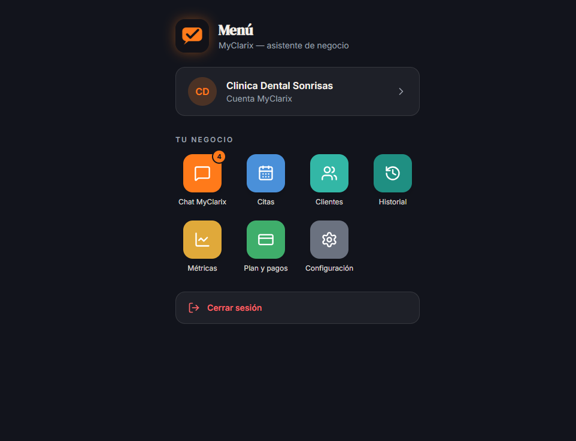
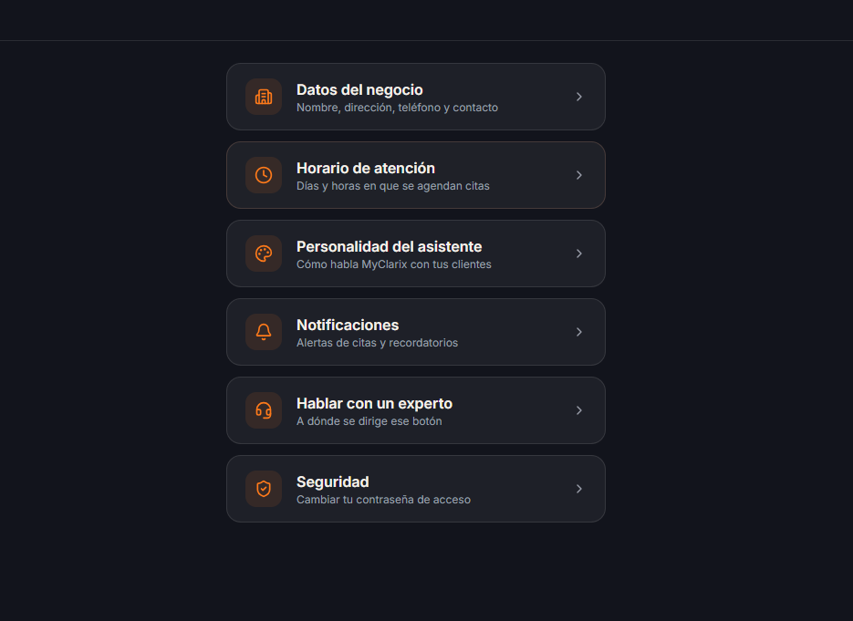

# MyClarix

Asistente de IA para negocios que atiende a sus clientes por chat y agenda citas por ellos, a cualquier hora. Producto de [Open Consultech](https://www.openconsultech.net).

**Web:** https://myclarix.com

> Este repositorio es una **presentación pública** del producto. El código fuente es privado.

*Capturas con un negocio de prueba.*

## Para qué sirve

Muchos negocios pierden citas porque no pueden contestar a todas horas. MyClarix responde por ellos: entiende fechas y horas escritas en lenguaje natural, agenda la cita, pide los datos de contacto y avisa al negocio.

- **Chat con IA** que agenda, confirma y reprograma citas sin formularios.
- **Un asistente por negocio**, con su propio nombre, tono de voz y contexto (servicios, horarios, precios).
- **Panel de administración** con citas, clientes, historial, plan y configuración.
- **Widget para la web del cliente:** se instala pegando un script.
- **Recordatorios de cita por email.**
- **Varios negocios en una misma plataforma**, con los datos de cada uno aislados.
- **App instalable** en el móvil (PWA).

## Tecnologías

- **Frontend:** Next.js, React, TypeScript, Tailwind CSS
- **Backend:** Node.js, Express, Prisma
- **Base de datos:** PostgreSQL (Supabase)
- **IA:** modelos de lenguaje a través de API
- **Pagos y email:** Stripe y Brevo
- **Hosting:** Vercel

## Autoría

Miguelina Rosario · [Open Consultech](https://www.openconsultech.net)

© Open Consultech. Todos los derechos reservados.
